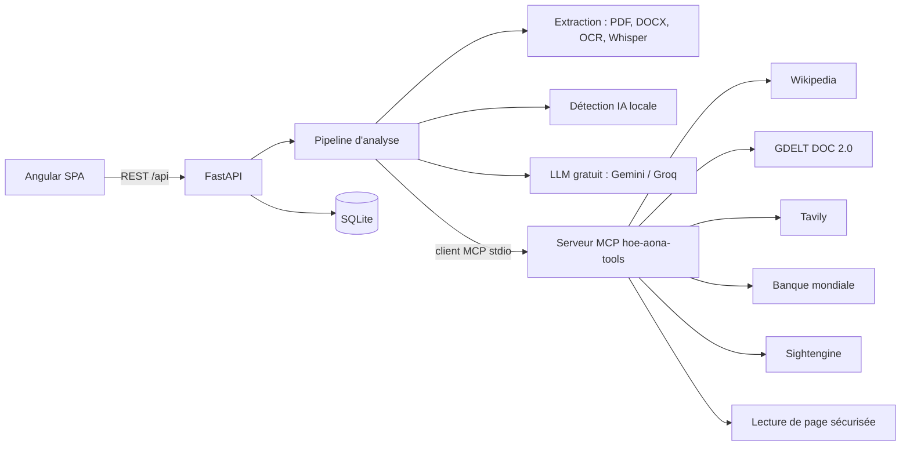

# Hoe-aona? : analyse du projet

## 1. Le besoin principal

La désinformation circule surtout sous forme de contenus courts et partagés sans contexte : captures d'écran, messages vocaux, chiffres repris sans source, images retouchées ou entièrement générées par IA. À Madagascar comme ailleurs, ces contenus passent d'abord par les réseaux sociaux et les messageries, où l'origine se perd en quelques partages.

Le problème n'est pas l'absence d'informations fiables. Les statistiques officielles, les vérifications des fact-checkers et les dépêches existent. Le problème est le coût de la vérification : pour un seul message, il faut identifier les affirmations vérifiables, chercher dans plusieurs bases, juger la fiabilité de chaque source, comparer les chiffres à la donnée officielle la plus récente, puis rédiger une réponse claire. Ce travail prend une à deux heures à un journaliste entraîné.

**Hoe-aona? répond à ce besoin : réduire le temps entre « je reçois un contenu douteux » et « je publie une vérification sourcée » à quelques minutes, sans sacrifier la traçabilité.** Chaque score est accompagné de ses preuves (liens, extraits, images, statistiques datées), et l'article proposé ne contient que ce que les preuves établissent.

## 2. Utilisateurs visés

| Profil                          | Ce qu'il apporte                            | Ce qu'il attend                                          |
| ------------------------------- | ------------------------------------------- | -------------------------------------------------------- |
| Journaliste, fact-checker       | Un post, un PDF, un audio reçu en rédaction | Des preuves citables et un brouillon d'article publiable |
| Enseignant, étudiant            | Un texte ou une image à étudier             | Comprendre pourquoi c'est vrai ou faux                   |
| Citoyen, modérateur de groupe   | Une capture d'écran, un message vocal       | Un verdict simple, vite, avec un lien à partager         |
| ONG, communicant institutionnel | Une rumeur qui vise leur domaine            | Les chiffres officiels à jour pour répondre              |

## 3. Exigences fonctionnelles

1. **Saisie multimodale** : texte, image, document (PDF, DOCX, TXT, HTML), audio (enregistré ou importé) et liens vers des sources.
2. **Extraction** : OCR et description des images, transcription audio, lecture des documents et des pages web.
3. **Détection de contenu IA** : signatures explicites (C2PA, IPTC `trainedAlgorithmicMedia`, paramètres Stable Diffusion/ComfyUI, logiciels générateurs dans l'EXIF ou les métadonnées PDF/DOCX, formules d'assistant, caractères invisibles), stylométrie, et détecteur externe optionnel pour les images.
4. **Exclusion des sources générées par IA** : toute page de preuve dont la probabilité IA dépasse le seuil réglé est retirée du calcul et listée à part avec la raison.
5. **Identification des affirmations vérifiables** (chiffres, événements, citations, faits sanitaires).
6. **Recherche de preuves via MCP** : encyclopédie, actualité mondiale, web (Tavily), statistiques officielles.
7. **Évaluation** : pour chaque preuve, position (confirme, contredit, contexte), confiance et justification. Pour chaque affirmation, arguments pour et contre, chacun relié à une preuve.
8. **Scores sur 10** : source, véracité des données, part d'IA, et score global pondéré.
9. **Preuves visibles** : lien, éditeur, date, extrait court, image de la source, statistiques avec année et date de mise à jour.
10. **Article prêt à publier** : titre, chapô, corps structuré, sources numérotées, export Markdown et HTML.
11. **Historique** filtrable et **paramètres** (pondérations, seuils, pays par défaut, langue du rapport, rétention).

## 4. Exigences non fonctionnelles

- **Traçabilité** : aucune affirmation de l'article sans référence `[n]` vers une source listée.
- **Gratuité** : uniquement des API avec offre gratuite permanente ; l'application reste utilisable, en mode dégradé, sans aucune clé.
- **Robustesse** : chaque outil peut échouer sans faire échouer l'analyse ; les échecs sont signalés comme avertissements.
- **Sécurité** : clés API côté serveur uniquement, protection SSRF lors de la lecture des pages, limites de taille sur les fichiers.
- **Responsive** : barre de navigation basse sur mobile, rail latéral sur grand écran.
- **Confidentialité** : rétention configurable, suppression d'une analyse à tout moment.

## 5. Architecture



Le backend lance un **serveur MCP** (`app/mcp/server.py`, FastMCP) qui expose chaque source de preuves comme un outil. Le pipeline les appelle par un **client MCP** (`app/mcp/gateway.py`). D'autres serveurs MCP peuvent être ajoutés dans `mcp_servers.json` sans modifier le code du pipeline. Un mode `direct` (sans sous-processus) existe pour le débogage.

### Déroulé d'une analyse

| Étape                | Progression | Détail                                                                         |
| -------------------- | ----------- | ------------------------------------------------------------------------------ |
| Lecture des données  | 5 %         | Extraction du texte de chaque entrée, lecture des liens fournis                |
| Signatures IA        | 20 %        | Analyse locale, puis détecteur externe si activé                               |
| Affirmations         | 30 %        | Le LLM isole jusqu'à 5 affirmations vérifiables ; repli heuristique sans LLM |
| Recherche de preuves | 45 %        | Appels MCP en parallèle, lecture des pages, exclusion des pages IA             |
| Évaluation           | 75 %        | Position de chaque preuve, arguments pour et contre, comparaison chiffrée      |
| Scores               | 88 %        | Calcul décrit ci-dessous                                                       |
| Article              | 95 %        | Rédaction contrainte par les preuves, repli sur un modèle sans LLM             |

## 6. Méthode de calcul des scores

**Fiabilité d'une source (0 à 1).** Base selon le type de domaine : institutions et statistiques officielles (0,90 à 0,96), fact-checkers reconnus (0,85 à 0,93), agences et grands médias (0,80 à 0,92), encyclopédie (0,75), médias locaux (0,60 à 0,70), domaine inconnu (0,50), réseaux sociaux et plateformes de blog (0,20 à 0,45). Ajustements : auteur identifié, date de publication, HTTPS, signatures IA.

**Vérité d'une affirmation (0 à 10).** Avec S la somme des `fiabilité × confiance` des preuves qui confirment et R celle des preuves qui contredisent :

```
score = 10 × (S + 0,3) / (S + R + 0,6)
```

Sans preuve, le score reste à 5 et le verdict est « non vérifiable ». Les verdicts : vrai (≥ 8), plutôt vrai (≥ 6), mitigé (entre 4 et 6), plutôt faux (≥ 2), faux (< 2).

**Critères affichés.**

| Critère              | Calcul                                                                                                      |
| -------------------- | ----------------------------------------------------------------------------------------------------------- |
| Source               | 55 % fiabilité de l'origine fournie (0,45 si aucune origine) + 45 % fiabilité moyenne des preuves décisives |
| Véracité des données | Moyenne des affirmations, pondérée par la quantité de preuves                                               |
| Fait par IA          | 10 × (1 − probabilité IA du contenu soumis)                                                                 |
| Global               | Moyenne pondérée, 40/40/20 par défaut, réglable                                                             |

Garde-fous : si la véracité est inférieure à 4, le score global est plafonné à 4,4 (une information fausse ne peut pas être « fiable ») ; si la probabilité IA dépasse 0,85, il est plafonné à 5,9.

Verdict global : fiable (≥ 8), plutôt fiable (≥ 6,5), à vérifier (≥ 4,5), douteux (< 4,5).

## 7. API et services gratuits retenus

| Service                      | Rôle                                             | Clé           | Offre gratuite constatée (oct. 2026) |
| ---------------------------- | ------------------------------------------------ | ------------- | ------------------------------------ |
| Wikipedia (MediaWiki + REST) | Contexte encyclopédique, images                  | Non           | Usage raisonnable avec User-Agent    |
| GDELT DOC 2.0                | Actualité mondiale, 65 langues, 3 derniers mois  | Non           | Libre, citation de GDELT demandée    |
| Tavily                       | Recherche web pour agents                        | Oui           | 1 000 crédits par mois               |
| Banque mondiale              | Statistiques officielles, valeur la plus récente | Non           | Libre                                |
| Groq                         | LLM rapide, vision, Whisper                      | Oui           | Limité par débit, sans carte         |
| Gemini (AI Studio)           | LLM principal, compatible OpenAI                 | Oui           | Limité par débit, sans carte         |
| Sightengine                  | Détection d'images générées                      | Oui           | Environ 400 vérifications par mois   |
| OCR.space                    | OCR de secours                                   | Oui           | Clé gratuite                         |

Les quotas changent régulièrement ; ils sont à revérifier avant la mise en production.

## 8. Risques et limites

- **Détection IA probabiliste** : aucun détecteur n'est une preuve. Seules les signatures explicites (C2PA, IPTC, paramètres de génération) sont quasi certaines ; la stylométrie sert d'indice et est plafonnée à 0,8.
- **Hallucinations du LLM** : le LLM ne juge qu'à partir des extraits fournis, chaque argument cite une preuve, et l'article ne reçoit que les preuves retenues. Les identifiants de preuve inventés sont ignorés.
- **Couverture locale** : GDELT et Tavily couvrent mal certaines actualités malgaches ; la liste de domaines locaux est à enrichir avec des rédactions partenaires.
- **Statistiques** : la Banque mondiale publie avec un ou deux ans de décalage. L'interface affiche toujours l'année de la donnée et la date de mise à jour de la base.
- **Droit d'auteur** : extraits limités à environ 400 caractères avec attribution ; l'article reformule et ne recopie pas les sources.
- **Données personnelles** : l'offre gratuite de Gemini peut servir à l'entraînement de Google hors UE ; pour des contenus sensibles, privilégier Groq ou une offre payante.

## 9. Évolutions possibles

Comptes et équipes, file de relecture humaine avant publication, recherche inversée d'images, sources statistiques nationales (INSTAT), extension navigateur, export direct vers un CMS.
